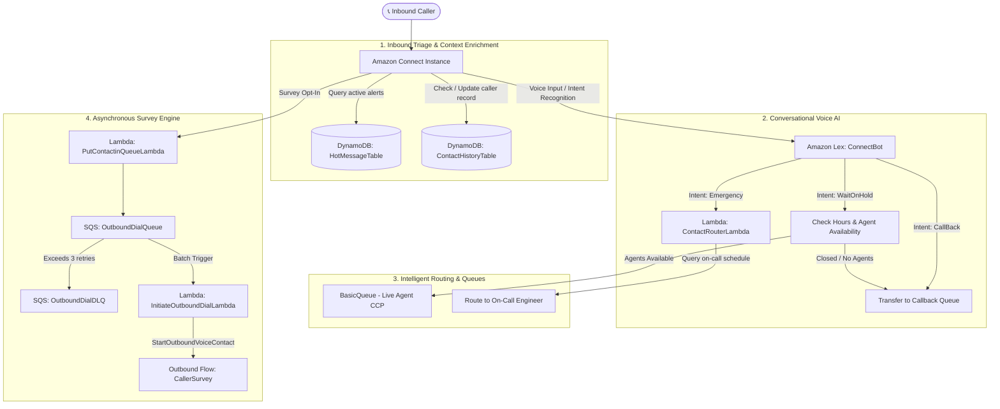
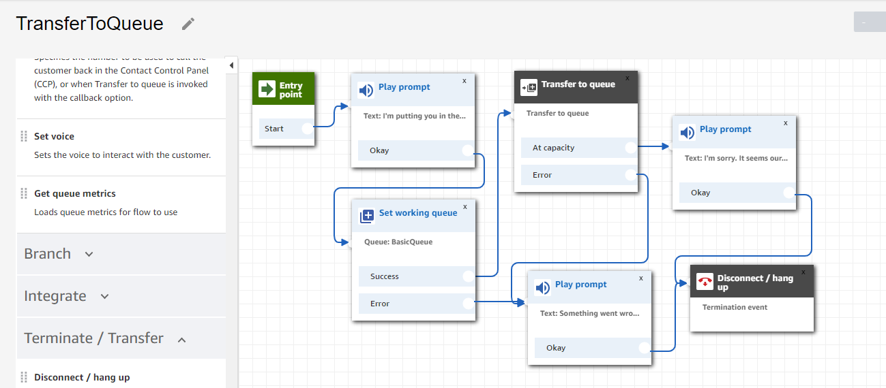
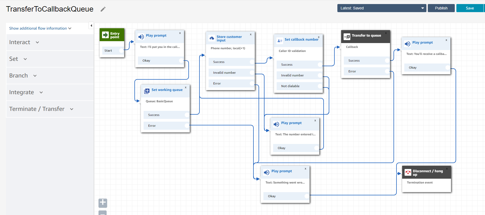
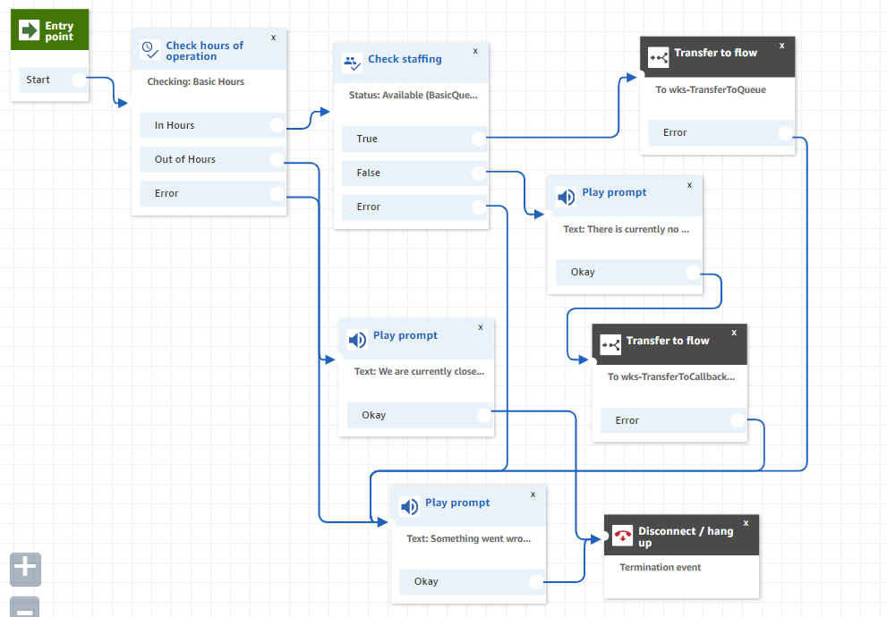
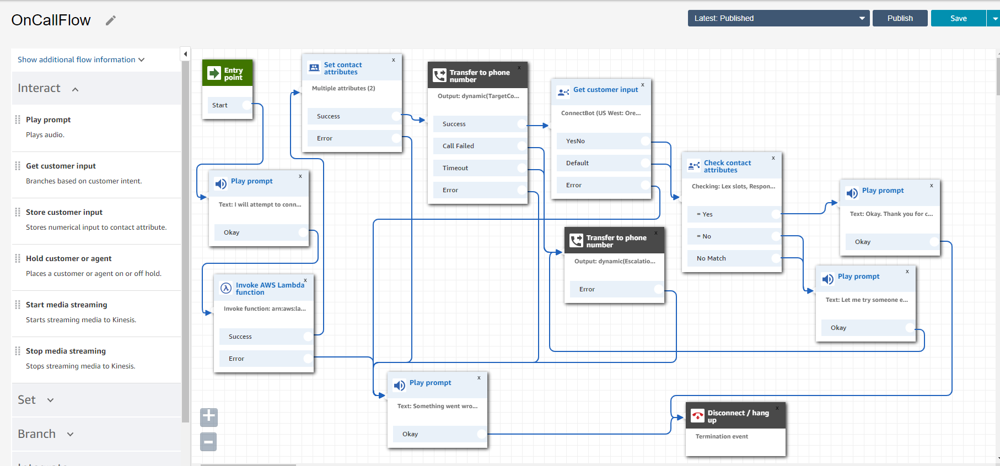
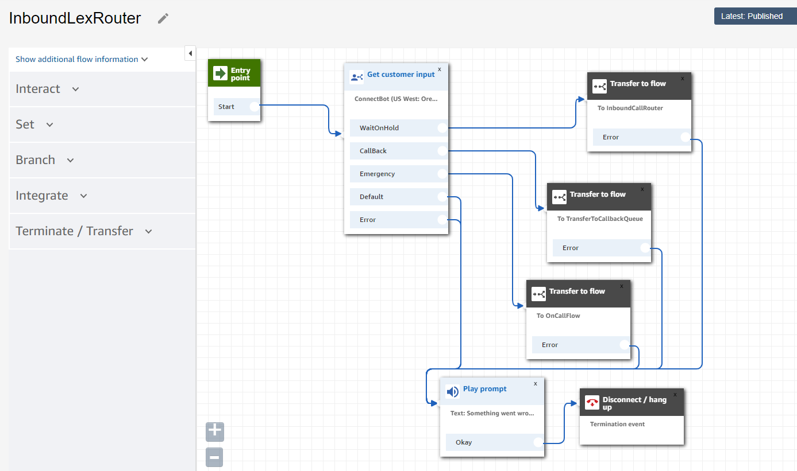
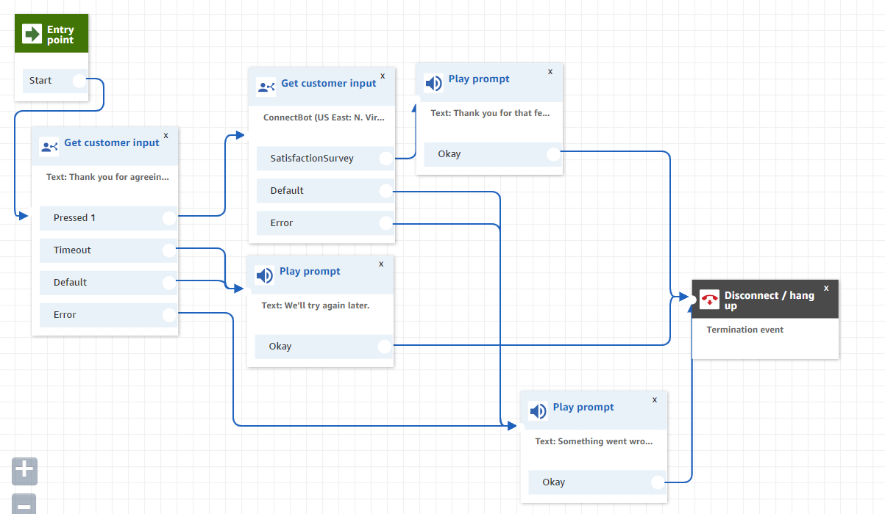
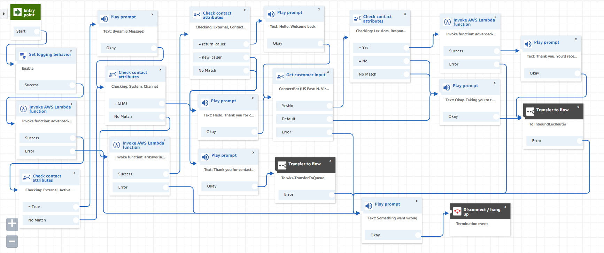
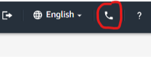

<div align="center">

# ☁️ Modern Serverless Contact Center with Amazon Connect

**An enterprise-grade, event-driven intelligent contact center reference architecture built on AWS.**

[](https://aws.amazon.com/connect/)
[](https://aws.amazon.com/lambda/)
[](https://aws.amazon.com/dynamodb/)
[](https://aws.amazon.com/sqs/)
[](https://aws.amazon.com/lex/)
[](https://aws.amazon.com/serverless/sam/)
[](LICENSE)

[Architecture](#-system-architecture) • [Key Features](#-key-features) • [Prerequisites](#-prerequisites) • [Deployment](#-deployment-guide) • [Contact Flows](#-contact-flows-walkthrough) • [Testing](#-testing--verification)

---

</div>

## 📌 Overview

This repository provides a production-ready blueprint for deploying an intelligent, automated, and scalable contact center. By integrating **Amazon Connect** with **AWS Lambda (Python 3.12)**, **Amazon Lex**, **Amazon DynamoDB**, and **Amazon SQS**, the system eliminates rigid IVR phone trees in favor of conversational, real-time data-driven customer experiences.

### Why This Architecture?
* **Zero Infrastructure Overhead:** Entirely serverless backend provisioned via AWS SAM (Serverless Application Model).
* **Context-Aware Personalization:** Dynamically detects first-time vs. returning callers to tailor greetings and expedite routing.
* **Resilient Asynchronous Outbound Engine:** Decouples post-call customer satisfaction surveys and callbacks using SQS queues backed by a dedicated Dead-Letter Queue (DLQ).
* **Dynamic Broadcast Announcements:** Instantly plays priority "hot messages" during outages or emergency advisories without republishing contact flows.

---

## 🏛️ System Architecture



---

## ✨ Key Features

| Feature | Service Component | Description |
| :--- | :--- | :--- |
| **Dynamic Hot Messages** | `GetHotMessageLambda` + DynamoDB | Broadcasts dynamic announcements based on UTC timestamps (`StartTimeStamp` and `EndTimeStamp`). |
| **Returning Caller Recognition** | `ContactLookupLambda` + DynamoDB | Evaluates caller history to personalize the IVR greeting (`"welcome back"` vs new caller registration). |
| **Voice AI Intent Routing** | Amazon Lex (`ConnectBot`) | Natural language understanding for callers to speak intents: *Hold*, *Callback*, or *Emergency*. |
| **Business Hours & Staffing** | Amazon Connect Contact Flows | Automatically inspects agent capacity in real-time, diverting callers to callback queues if agents are unavailable. |
| **On-Call Emergency Escalation** | `ContactRouterLambda` | Automatically routes after-hours emergency calls according to a dynamic day-of-week on-call schedule. |
| **Automated Callback Surveys** | `PutContactinQueueLambda`, SQS & Connect | Queues outbound customer survey calls upon call disconnect, handling rate limits with automated retries. |

---

## 📁 Repository Structure

```plaintext
├── .gitignore                      # Git ignore rules for AWS SAM, Python, and OS files
├── CODE_OF_CONDUCT.md              # Community code of conduct guidelines
├── CONTRIBUTING.md                 # Contribution workflows and pull request standards
├── ConnectBot.zip                  # Packaged Amazon Lex conversational bot definition
├── LICENSE                         # MIT License
├── README.md                       # Comprehensive project documentation
├── full-template.yml               # AWS SAM CloudFormation template (Python 3.12)
├── contact-flows/                  # Exported Amazon Connect contact flow JSON definitions
│   ├── CallerSurvey                # Outbound satisfaction survey contact flow
│   ├── EntryPoint                  # Primary inbound entry point and triage flow
│   ├── InboundCallRouter           # Hours of operation and staffing validation
│   ├── InboundLexRouter            # Amazon Lex conversational router
│   ├── OnCallFlow                  # Emergency escalation and routing flow
│   ├── TransferToCallbackQueue     # Queue placement for automated callback
│   └── TransferToQueue             # Direct agent queue transfer
└── images/                         # Architectural diagrams and contact flow captures
    ├── 1_TransferToQueue.png
    ├── 2_CCP.png
    ├── 3_TransferToCallbackQueue.png
    ├── 4_InboundCallRouter.png
    ├── 5_OnCallFlow.png
    ├── 6_InboundLexRouter.png
    ├── 7_CallerSurvey.png
    └── 8_EntryPoint.png
```

---

## 📋 Prerequisites

Before getting started, ensure you have:
1. An **AWS Account** with administrative permissions.
2. The **[AWS CLI](https://aws.amazon.com/cli/)** installed and authenticated (`aws configure`).
3. The **[AWS SAM CLI](https://docs.aws.amazon.com/serverless-application-model/latest/developerguide/install-sam-cli.html)** installed.
4. An active **Amazon Connect instance** provisioned in an AWS region supporting telephony (e.g., `us-east-1` or `us-west-2`).

---

## 🚀 Deployment Guide

### Step 1: Deploy Serverless Backend (AWS SAM)

Clone this repository and build the SAM application:

```bash
# Clone the repository
git clone https://github.com/<your-username>/amazon-connect-contact-center.git
cd amazon-connect-contact-center

# Build the SAM application
sam build -t full-template.yml

# Deploy with guided configuration
sam deploy --guided
```

#### Parameters to Supply:
* **Stack Name:** `amazon-connect-backend`
* **AWS Region:** Same region as your Amazon Connect instance (e.g. `us-east-1`)
* **UserPhoneNumber:** Your mobile or direct dial number in E.164 format (e.g., `+1XXXXXXXXXX`) to act as the emergency escalation target.

#### Resources Provisioned:
* `ContactHistoryTable` & `HotMessageTable` (Amazon DynamoDB)
* `OutboundDialQueue` & `OutboundDialDLQ` (Amazon SQS with Dead-Letter redrive policy)
* `ContactLookupLambda`, `ContactRouterLambda`, `GetHotMessageLambda`, `PutContactinQueueLambda`, `InitiateOutboundDialLambda` (Python 3.12 AWS Lambda functions)

---

### Step 2: Set Up Amazon Connect Instance

1. Open the [Amazon Connect Console](https://console.aws.amazon.com/connect/).
2. Select **Add an instance**:
   * **Identity management:** Store users within Amazon Connect. Enter a unique access URL.
   * **Administrator:** Create an admin user credential.
   * **Telephony:** Check both **Incoming calls** and **Outbound calls**.
   * Review and click **Create instance**.
3. Access your instance URL and claim a phone number (Direct Inward Dialing).

---

### Step 3: Import Conversational Bot (Amazon Lex)

1. Open the **Amazon Lex Console**.
2. Select **Bots** > **Actions** > **Import**.
3. Upload [`ConnectBot.zip`](ConnectBot.zip) and import the bot.
4. Build and publish the bot as `ConnectBot` with an alias.

---

### Step 4: Grant Connect Permissions to Call Resources

1. Return to the **Amazon Connect Console** and click on your instance name.
2. Select **Contact flows** in the left menu.
3. Under **Amazon Lex**, associate the imported bot `ConnectBot`.
4. Under **AWS Lambda**, associate the following Lambda functions deployed by SAM:
   * `ContactLookupLambda`
   * `ContactRouterLambda`
   * `GetHotMessageLambda`
   * `PutContactinQueueLambda`
   * `InitiateOutboundDialLambda`

---

## 📞 Contact Flows Walkthrough

Import the contact flow files in order from [`contact-flows/`](contact-flows/) into Amazon Connect (**Routing** > **Contact Flows** > **Create contact flow** > **Import flow**):

### 1. `TransferToQueue`
* **File:** [`contact-flows/TransferToQueue`](contact-flows/TransferToQueue)
* **Diagram:** 
* Sets working queue to `BasicQueue`, plays a prompt, and transfers the caller with queue-full error handling.

### 2. `TransferToCallbackQueue`
* **File:** [`contact-flows/TransferToCallbackQueue`](contact-flows/TransferToCallbackQueue)
* **Diagram:** 
* Queues a customer callback request, allowing callers to hang up without losing their queue position.

### 3. `InboundCallRouter`
* **File:** [`contact-flows/InboundCallRouter`](contact-flows/InboundCallRouter)
* **Diagram:** 
* Checks business hours of operation and verifies agent staffing before transferring to queue or callback.

### 4. `OnCallFlow`
* **File:** [`contact-flows/OnCallFlow`](contact-flows/OnCallFlow)
* **Diagram:** 
* Invokes `ContactRouterLambda` to determine today's on-call engineer and connects the emergency transfer.

### 5. `InboundLexRouter`
* **File:** [`contact-flows/InboundLexRouter`](contact-flows/InboundLexRouter)
* **Diagram:** 
* Uses Amazon Lex to interpret voice intent (`WaitOnHold`, `CallBack`, or `Emergency`) and branches accordingly.

### 6. `CallerSurvey`
* **File:** [`contact-flows/CallerSurvey`](contact-flows/CallerSurvey)
* **Diagram:** 
* Outbound survey contact flow capturing feedback on agent service.

### 7. `EntryPoint` (Master Flow)
* **File:** [`contact-flows/EntryPoint`](contact-flows/EntryPoint)
* **Diagram:** 
* The root flow bound to your claimed phone number. Checks hot messages, identifies returning callers, prompts for survey consent, and routes to `InboundLexRouter`.

---

## 🧪 Testing & Verification

1. **Claimed Number Configuration:**
   * In Amazon Connect, go to **Channels** > **Phone numbers**.
   * Link your claimed number to the **`EntryPoint`** contact flow.
2. **Log in to Agent CCP:**
   * Open the Contact Control Panel (CCP) by clicking the phone icon in the top right header:
   * 
   * Toggle status between **Available** and **Offline**.
3. **Verification Scenarios:**
   * **New Caller Test:** Dial the number. Confirm you are welcomed as a new caller. Check DynamoDB `ContactHistoryTable` for the new entry.
   * **Returning Caller Test:** Call a second time from the same number. Confirm the IVR responds: *"Welcome back!"*
   * **Survey Queue Test:** Agree to the post-call survey prompt. Hang up. Confirm `PutContactinQueueLambda` writes to SQS, and `InitiateOutboundDialLambda` dials you back for the automated survey.
   * **Emergency Escalation Test:** Speak *"Emergency"* to Lex. Verify that the call is routed to your configured `UserPhoneNumber`.

---

## 🛡️ Reliability & Security Best Practices

* **Python 3.12 Runtime:** Powered by the latest stable AWS Lambda runtime with optimized startup performance.
* **Dead Letter Queue (DLQ):** Messages failing after 3 attempts are isolated in `OutboundDialDLQ` for inspection, protecting SQS from toxic message cycles.
* **On-Demand Capacity:** DynamoDB tables use `PAY_PER_REQUEST` billing mode, scaling instantly with zero idle costs.
* **Defensive DynamoDB Updates:** Caller lookups execute atomic `update_item` queries, safeguarding customer state across high-volume concurrency.

---

## 🤝 Contributing

Contributions, bug reports, and enhancements are welcome! Please review [CONTRIBUTING.md](CONTRIBUTING.md) and our [CODE_OF_CONDUCT.md](CODE_OF_CONDUCT.md) before submitting pull requests.

---

## 📄 License

This project is licensed under the **MIT License** — see the [LICENSE](LICENSE) file for details.
